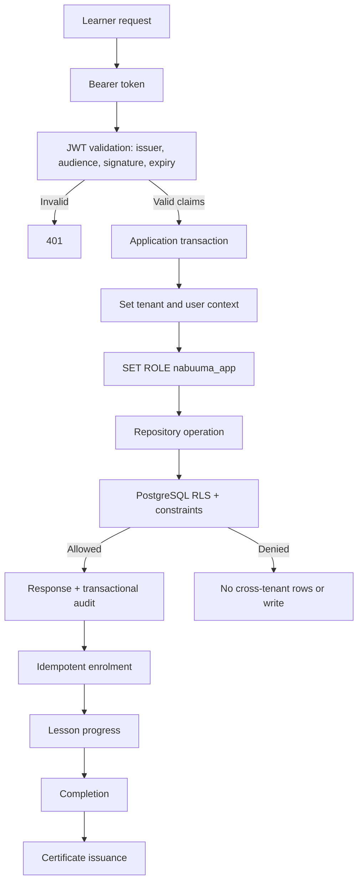
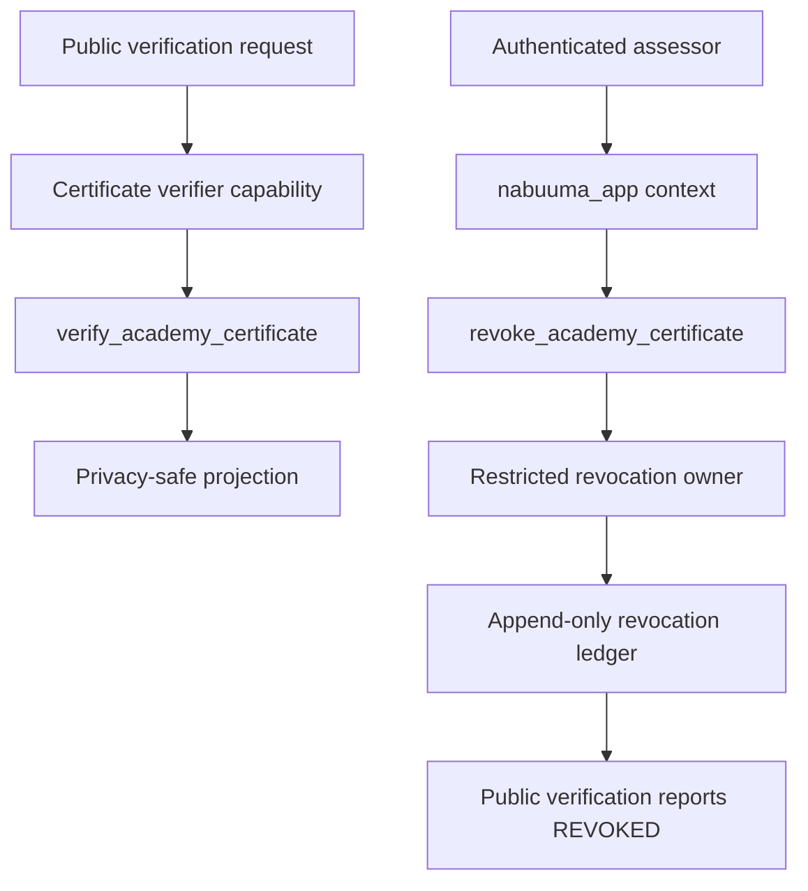

# Academy Enrolment & Certificate Hardening — Engineering Milestone

**Repository:** `mavadojunior/Nabuuma-Hospitality-platform-`
**Branch anchor:** `feat/academy-enrolment-certificate-hardening`
**Baseline commit:** `a442300e5002a512064b4ff2e9a7b4fd160aaa00`
**Milestone status:** BLOCKED — source remediation verified; migration 00020 unapplied; clean replay diverges on audit ledger; certificate HTTP and learner E2E release journeys remain blocked
**Evidence convention:** `VERIFIED`, `HISTORICAL`, `PENDING`, `BLOCKED`, `NOT APPLICABLE`

This document is an engineering record and a learner-facing explanation. A status is only VERIFIED when a command or request was executed during this milestone and its result was captured. Historical evidence is not presented as a fresh pass.

## 1. Milestone overview and provenance

The milestone hardens Academy enrolment, learner progress, completion, certificate issuance, public verification, and restricted revocation. It focuses on tenant isolation at both the application and database layers, transaction-safe audit records, least-privilege database roles, and predictable local operations.

### Security objectives

- Require a validated JWT before learner-facing protected routes execute.
- Scope repository operations to the tenant and subject asserted by validated token claims.
- Enforce tenant and learner isolation with PostgreSQL RLS, including forced RLS on Academy tables.
- Make enrolment retry-safe and completion/certificate issuance transactional.
- Keep audit records immutable and preserve audit-referenced fixture identities.
- Separate public certificate verification from authenticated revocation.
- Keep the API on a least-privilege runtime role, not a database owner or administrator.

### Provenance

The baseline commit `a442300` is the previously pushed hardening branch. Startup reconciliation was implemented during this verification phase; it is not part of that baseline commit. This document and the startup wrapper are currently uncommitted.

## 2. System architecture and request lifecycle

### Canonical startup and environment precedence

`.env.production` is deliberately not part of the local recovery-copy startup path. It previously pointed to a separate, unidentified PostgreSQL target on port 55432. This milestone does not read, source, probe, or alter that target.

`npm start` now invokes `scripts/start-runtime.sh`. The wrapper sources only the private Termux runtime file, validates the exact approved database target, requires identity-provider configuration, binds the API to loopback, and starts the built server.

```mermaid
flowchart TD
  A[Manual: npm start] --> C[Canonical start-runtime.sh]
  B[Termux boot script] --> C
  C --> D[Private runtime.env]
  D --> E{Exact target validation}
  E -->|127.0.0.1:55433 / nabuuma_rls_test / nabuuma_runtime| F[Start dist/server.js]
  E -->|Mismatch or missing config| G[Fail closed]
  H[.env.production] -. not loaded .-> C
  F --> I[API loopback :3000]
  I --> J[/health/live]
  I --> K[/health/ready]
```

The wrapper rejects unexpected host, port, database, or username values. It also rejects a symlinked or non-user-owned runtime file and any group/other permission bits (the current private file mode is 600). It does not grant privileges, execute migrations, or alter PostgreSQL authentication.

### Learner request lifecycle



The learner workflow is designed to progress from tenant-scoped discovery to enrolment, lesson progress, completion, and certificate issuance. A retry of enrolment should resolve to the same enrolment rather than create duplicates. Completion and audit issuance must commit together.

### Certificate verification and revocation authority



The public response is intended to reveal only certificate number, issue time, course title, validity status, and revocation time. It must not expose learner identifiers, tenant IDs, enrolment IDs, assessor IDs, or revocation reasons.

## 3. Security and least-privilege architecture

### Role separation

| Role | Intended authority |
|---|---|
| `nabuuma_runtime` | Login role used by the API; limited membership to application role |
| `nabuuma_app` | Application operations under transaction-local tenant/user context |
| `nabuuma_auth_owner` | Non-login owner of certificate verification function, with narrow column access |
| `nabuuma_certificate_verifier` | Non-login capability role allowed to execute the privacy-safe verifier |
| `nabuuma_certificate_revoke_owner` | Non-login owner of restricted revocation function; narrow column grants and RLS |
| Migration/database owner | Schema evolution and privileged administration, not application traffic |

**Learner note:** A runtime login should not own tables or bypass RLS. A function owner can be granted the minimum columns and policies needed for one operation. A `SECURITY DEFINER` function executes with its owner authority, so its owner, grants, RLS policies, and fixed `search_path` are part of the security boundary.

### Row-Level Security

The Academy tables audited in this milestone have both `ENABLE ROW LEVEL SECURITY` and `FORCE ROW LEVEL SECURITY`:

- `academy_courses`
- `academy_enrolments`
- `academy_certificates`
- `academy_certificate_revocations`

RLS provides a storage-layer backstop. If application code forgets a tenant predicate, the database policy still limits which rows the current transaction can read or mutate. `FORCE ROW LEVEL SECURITY` also subjects table owners to RLS in ordinary table access, except roles with `BYPASSRLS` or superuser authority.

RLS does not replace correct authentication or transaction context. An empty, missing, or incorrectly set tenant/user context must fail closed.

### Migrations 00016–00019

| Migration | Purpose |
|---|---|
| `00016_restore_audit_event_id_defaults.sql` | Restore server-generated audit event identifiers |
| `00017_restore_audit_correlation_id_nullability.sql` | Restore nullable correlation identifiers |
| `00018_reconcile_certificate_verification_authority.sql` | Establish a restricted verifier owner, column grants, verifier policies, fixed search path, and function execute boundary |
| `00019_harden_certificate_revocation_authority.sql` | Establish a restricted revocation owner, column grants, RLS policies, append-only ledger, and fixed search path |
| `00020_allow_runtime_certificate_verification.sql` | Proposed narrow `EXECUTE` grant to runtime; verifies function authority and denies verifier membership/direct table access |

A `SECURITY DEFINER` function must use a fixed trusted `search_path` (here `pg_catalog`) and schema-qualify application objects. Otherwise, an attacker may influence object resolution. The verifier and revoker owners are intended to be non-login, non-superuser, non-BYPASSRLS roles. Migration 00020 requires schema `USAGE` so the runtime can resolve the function, but does not grant table access; function `EXECUTE` remains the sole data-operation capability.

### Authority audit evidence

**VERIFIED — recovery-copy catalog inspection (read-only):**

- RLS enabled and forced on the four Academy tables listed above.
- `verify_academy_certificate`: SECURITY DEFINER, owner `nabuuma_auth_owner`, configured `search_path=pg_catalog`.
- `revoke_academy_certificate`: SECURITY DEFINER, owner `nabuuma_certificate_revoke_owner`, configured `search_path=pg_catalog`.
- `nabuuma_runtime`: LOGIN, not SUPERUSER, not BYPASSRLS.
- `nabuuma_app`, verifier, auth owner, and revocation owner: non-login roles in the catalog snapshot.

**BLOCKED — migration-state and full privilege assertions:** the runtime login cannot read the application schema's migration metadata or all grant/policy definitions. No separate administrative read-only credential was supplied for this verification. No migration was applied.

**REMEDIATION IMPLEMENTED, DATABASE APPLY BLOCKED:** `PgCertificateVerifier` no longer executes `SET LOCAL ROLE nabuuma_certificate_verifier`. New migration `00020_allow_runtime_certificate_verification.sql` grants `USAGE` on schema `nabuuma` and only `EXECUTE` on `nabuuma.verify_academy_certificate(TEXT)` to `nabuuma_runtime`, then verifies function owner, SECURITY DEFINER, hardened search path, no verifier-role membership, and no direct certificate-table SELECT. Applying the migration using the approved runtime connection failed with `permission denied for schema nabuuma` before the grant. No database changes were applied. The public verification HTTP canary still returns 500. A migration-capable approved database owner is required to apply 00020; runtime elevation or verifier membership is not permitted.

## 4. Canonical startup and operational runbook

### Preconditions

- Termux PostgreSQL recovery-copy instance is listening on loopback port 55433.
- Private runtime configuration exists at `~/.config/nabuuma/runtime.env`.
- The runtime URL identifies database `nabuuma_rls_test` and role `nabuuma_runtime`.
- Identity configuration keys are present; their values must never be printed or committed.
- Production build exists in `dist/`.

### Start

From the repository root:

```bash
cd ~/Nabuuma-Hospitality-platform-
npm run build
npm start
```

The start wrapper fails closed when the private config is absent or the target does not exactly match the recovery-copy allowlist. It does not load `.env.production`.

### Health checks

```bash
curl -i http://127.0.0.1:3000/health/live
curl -i http://127.0.0.1:3000/health/ready
curl -i http://127.0.0.1:3000/api/v1/academy/courses
```

Expected responses:

- `/health/live`: `200 {"status":"LIVE"}`
- `/health/ready`: `200 {"status":"READY"}`
- Protected Academy route without bearer token: `401 UNAUTHENTICATED`

### Isolated runtime-auth integration test

This test uses the private runtime URL, validates its local/55433/database allowlist, generates a synthetic key/token, injects the verifier, and exercises runtime health/authentication/course discovery. It does not seed or delete fixture rows.

```bash
cd ~/Nabuuma-Hospitality-platform-
set -a
. "$HOME/.config/nabuuma/runtime.env"
set +a
export NABUUMA_TEST_DATABASE_URL="$DATABASE_URL"
npx vitest run tests/RuntimeAuthentication.integration.spec.ts \
  --pool=forks --maxWorkers=1 --reporter=verbose
unset NABUUMA_TEST_DATABASE_URL DATABASE_URL
```

### Recovery

If startup rejects the target:

1. Stop and do not retry with a different role or database.
2. Inspect only runtime key names and the URL's non-secret host/port/database/username components.
3. Correct the private runtime file outside Git.
4. Re-run the canonical wrapper.
5. Confirm liveness and readiness before sending authenticated traffic.

Do not source or run `scripts/validate_runtime_env.sh` or legacy E2E scripts that target port 55432. They are excluded from this milestone. The root `verify-release.sh` is also excluded: it performs privileged checks, creates temporary roles, and may apply migrations; it is not a read-only runtime audit.

## 5. Reproducible verification matrix

Every item is evidence-tagged. The commands and results below describe the current verification session.

| Check | Status | Evidence/result |
|---|---|---|
| Branch and baseline commit | VERIFIED | Branch `feat/academy-enrolment-certificate-hardening`; baseline `a442300e5002a512064b4ff2e9a7b4fd160aaa00` |
| Canonical startup wrapper shell syntax | VERIFIED | `bash -n scripts/start-runtime.sh` → PASS |
| Unsafe-target canary | VERIFIED | Synthetic 55432 / nabuuma_test URL refused by wrapper validator; no connection attempted |
| Private runtime file ownership/mode | VERIFIED | Current owner UID matches Termux UID; mode 600 |
| Startup configuration regression test | VERIFIED | `tests/ProductionBuildConfig.spec.ts`: 4/4 passed |
| Production build before restart | VERIFIED | `npm run build` → exit 0 |
| Manual canonical `npm start` restart | VERIFIED | API restarted after graceful stop; wrapper log shows `bash scripts/start-runtime.sh` |
| Live `/health/live` | VERIFIED | HTTP 200; `{"status":"LIVE"}` |
| Live `/health/ready` | VERIFIED | HTTP 200; `{"status":"READY"}` |
| Protected course endpoint without token | VERIFIED | HTTP 401; `UNAUTHENTICATED` |
| Protected routes with malformed token | VERIFIED | Live probes returned 401 |
| Synthetic signed JWT runtime integration | VERIFIED | 7/7 tests passed; includes issuer/audience/expiry rejection and authenticated course discovery |
| RLS enabled + forced on four Academy tables | VERIFIED | Recovery-copy PostgreSQL catalog query |
| Verification function owner/security/search path | VERIFIED | Catalog: `nabuuma_auth_owner`, SECURITY DEFINER, `pg_catalog` |
| Revocation function owner/security/search path | VERIFIED | Catalog: `nabuuma_certificate_revoke_owner`, SECURITY DEFINER, `pg_catalog` |
| Runtime role attributes | VERIFIED | LOGIN; no SUPERUSER or BYPASSRLS (prior catalog evidence) |
| Direct certificate table access canary | VERIFIED DENIED | Runtime query returns `permission denied for schema nabuuma`; no table rows accessed |
| Runtime role-switch canary | VERIFIED DENIED | Fresh `SET LOCAL ROLE nabuuma_certificate_verifier` returns `permission denied to set role` |
| Public unknown-certificate verification | BLOCKED | Canonical API restart: HTTP 500 remains; migration 00020 not applied because runtime lacks schema privilege to grant USAGE/EXECUTE |
| Authenticated same-tenant discovery over live TCP | BLOCKED | No external test-token signing authority supplied; private runtime config exposes JWKS URL only (values not printed) |
| Idempotent HTTP enrolment | BLOCKED | Requires isolated synthetic tenant fixture and authenticated token; admin fixture credentials unavailable |
| Cross-tenant HTTP isolation | BLOCKED | Requires isolated synthetic tenant fixtures and authenticated tokens; admin fixture credentials unavailable |
| Lesson-progress HTTP journey | BLOCKED | Requires isolated learner/enrolment/lesson fixtures and authenticated token; fixture credentials unavailable |
| Completion and certificate issuance | BLOCKED | Requires isolated learner fixtures and writable fixture authority; admin fixture credentials unavailable |
| Revocation HTTP journey | BLOCKED | Requires isolated authorized assessor/certificate fixtures and fixture authority; credentials unavailable |
| Migration 00020 application | BLOCKED | Runtime connection returned `permission denied for schema nabuuma` on GRANT; no privileges changed |
| Migration 00016–00019 applied-state audit | BLOCKED | No separate read-only administrative connection supplied |
| Immutable fixture counts (18 organisations / 19 users) | HISTORICAL | Previously reported; not freshly queried because runtime role cannot access schema |
| Fixture cleanup | NOT APPLICABLE | No fixture cleanup or seed operation run during this session |
| Typecheck | VERIFIED | Fresh `npm run typecheck` → exit 0 |
| Build | VERIFIED | Fresh `npm run build` → exit 0 |
| ESM import verification | VERIFIED | `npm run verify:esm-imports` → 69 modules, 92 relative imports |
| Full default test suite | VERIFIED | Fresh `npm test`: 31 files passed, 9 skipped; 197 passed, 46 skipped (243 total), zero failed |
| Initial full suite after startup change | HISTORICAL | 191 passed, 1 failed, 46 skipped (238 total); stale start-script assertion was corrected, then fresh suite passed |
| Git diff / secret scan | VERIFIED | `git diff --check` PASS; targeted secret-pattern scan on migration, docs, startup script PASS; no credential values emitted |

### Captured live HTTP results

| Request | Status | Body summary |
|---|---:|---|
| `GET /health/live` | 200 | `LIVE` |
| `GET /health/ready` | 200 | `READY` |
| `GET /api/v1/academy/courses` (no token) | 401 | Authentication required |
| `GET /api/v1/academy/courses/:id/lessons` (malformed token) | 401 | Authentication required |
| `GET /api/v1/academy/certificates` (malformed token) | 401 | Authentication required |
| `POST /api/v1/academy/courses/:id/enrolments` (no token) | 401 | Authentication required |
| `GET /api/v1/academy/certificates/NAB-UNKNOWN/verification` | 500 | Generic internal error; known verifier-role integration defect |

### Runtime authentication suite

Command:

```bash
npx vitest run tests/RuntimeAuthentication.integration.spec.ts \
  --pool=forks --maxWorkers=1 --reporter=verbose
```

**VERIFIED:** 1 file passed; 7 tests passed; exit code 0. The test runtime used `NABUUMA_TEST_DATABASE_URL` sourced from the private runtime configuration. No fixture writes or deletes are performed by this suite. This is Fastify injection plus a live database query, not an external TCP request to the running API.

## 6. Immutable fixtures, boundaries, and next steps

The MCP PostgreSQL E2E fixture cleanup implementation removes mutable Academy state for its synthetic tenant IDs, including progress, certificates, enrolments, courses, lessons, and memberships. It intentionally preserves organisation/user identities referenced by immutable audit records.

No E2E fixture cleanup ran during this milestone. The previously observed 18 organisation and 19 user fixture counts are historical, not fresh evidence. The runtime role cannot query those tables directly, and this session did not use an administrator to seed, delete, or inspect them.

### Operational boundaries

- Local Termux recovery-copy topology is verified; this is not production deployment evidence.
- Port 55432 is outside scope and was not probed, sourced, or modified.
- No migrations were executed.
- Runtime role was not elevated.
- No audit-linked fixture records were deleted.
- No credentials or private runtime environment file are included in this document.
- The public certificate verification HTTP 500 is an unresolved release blocker.
- Full learner HTTP E2E and migration-state audit require an approved fixture/admin-read-only setup or a separate safe test environment.

### Handoff criteria

Before production readiness is claimed:

1. Have an approved migration-capable database owner apply migration 00020 to the approved target, then independently verify its grant and guardrails.
2. Restart through canonical `npm start` and re-run unknown/valid/revoked public verification and privacy projection checks.
3. Run same-tenant discovery, idempotent enrolment, cross-tenant isolation, progress, completion, issuance, and authorized revocation through HTTP using isolated synthetic fixtures and a dedicated fixture-authority credential.
4. Fresh validation: typecheck/build/ESM PASS; full default suite PASS (197 passed, 46 skipped, 243 total). Targeted verifier+migration config PASS (11/11).
5. Review the complete Git diff and secret scan. Commit/push only after explicit owner sign-off.

**Milestone is not production-certified while the public certificate verification integration returns HTTP 500 or the authenticated learner E2E matrix remains blocked.**


## 7. Fresh cross-repository execution — 2026-11-22

### Backend evidence

- Migration lineage: 00001–00020 enumerated; numeric prefixes unique and sequential. Migration 00020 is present and unchanged. No migration was applied.
- Runtime catalog postconditions: schema `nabuuma` USAGE=false; verification function EXECUTE=false; direct certificate table SELECT=false; verifier membership=false; runtime SUPERUSER=false and BYPASSRLS=false.
- Function metadata: owner `nabuuma_auth_owner`, SECURITY DEFINER=true, `search_path=pg_catalog`.
- Security canaries: `SET ROLE nabuuma_certificate_verifier` denied; direct certificate table SELECT denied at schema boundary.
- Live HTTP: `/health/live` 200; `/health/ready` 200; unknown public certificate verification 500.
- Anonymous probes across courses, lessons, certificates, enrolment, progress, completion, and revocation returned HTTP 401. No authenticated mutation was attempted.
- Safe integration suites using the approved runtime URL and synthetic in-process signing keys: RuntimeAuthentication and PgTransactionManager pool-isolation, 9/9 PASS. These do not seed/delete fixtures; authenticated course discovery is Fastify injection against the live recovery-copy database, not external TCP/Auth0 authentication.
- Fresh default test suite: 31 files passed, 9 skipped; 197 tests passed, 46 skipped (243 total); 0 failures. Targeted verifier/API/migration/security selection: 16 passed, 2 skipped. Typecheck, build, ESM (69 modules / 92 relative imports) PASS.
- `git diff --check` PASS for backend and mobile. High-risk secret-pattern scan PASS after excluding the known CI test URL placeholder in `ProductionBuildConfig.spec.ts`; no secret values were printed.

### Migration and audit-ledger replay blocker

- Migration 00005 creates `nabuuma.audit_events` as a non-partitioned heap table. The migration lineage contains no partition-conversion migration; 00016/00017 only reconcile column defaults/nullability on any attached partitions.
- Current recovery-copy catalog reports `audit_events` as a partitioned parent with RLS enabled and FORCE RLS enabled, 24 monthly partitions from 2026-10 through 2028-09, and no default partition. The current policies are named `audit_events_tenant_select` and `audit_events_tenant_insert`; the historical 00005 policy names differ.
- This is observed schema divergence, not a data-integrity proof. Runtime catalog access did not expose audit row contents. No row count/equality proof or fresh replay was performed.
- CLEAN_REPLAY_BLOCKED: the runtime role has no CREATEDB/CREATEROLE authority, no migration owner credential was found, and the existing `nabuuma_test` database was not used. A future audit reconciliation candidate is 00021; no migration file was created. A conversion must prove row preservation, RLS/FORCE RLS, append-only controls, tenant policies, and future partition continuity before implementation/application.

### Mobile evidence

- Repository: `~/Nabuuma-Mobile`, branch `master`. Local changes preserved; no commit.
- Expo SDK updated within the same SDK patch line to 58.0.26 and expo-dev-client 58.0.21. `npx tsc --noEmit`, `npx expo install --check`, `npx expo-doctor@latest` (20/20), and `npx expo config --type introspect` PASS.
- Auth0 local public configuration matches the expected domain, API audience, and native client ID. `.env.local` is mode 0600 and ignored. Android and iOS generated callback schemes are present in local native manifests. Remote Auth0 callback allowlist was not verified; no Management API authority supplied. Backend runtime JWT configuration was freshly checked and currently points to a Supabase issuer/JWKS with audience `authenticated`, which does not match the mobile Auth0 issuer or `https://api.nabuuma.com` audience. No runtime auth configuration was changed; Auth0-to-backend integration is blocked on an approved identity-provider alignment.
- EAS profiles explicitly map development, preview, and production to matching environments. EAS `whoami` returned Not logged in; project ID absent; EXPO_TOKEN absent. EAS config inspection requires an Expo account. Project linking, remote environment variables, and cloud build are BLOCKED.
- Android SDK/Gradle are absent in Termux. Android export with Hermes bytecode failed because the compiler does not support Termux's Android host. Retry `npx expo export --platform android --no-bytecode` succeeded and produced the JS bundle; this is not an APK build.
- App currently authenticates with Auth0 and displays the user profile; no Nabuuma API request is implemented. Mobile-to-backend, installed app, Universal Login callback runtime, and tenant-isolation journeys are NOT EXECUTED. The current Auth0/Supabase issuer-audience mismatch is an additional confirmed integration blocker.
- npm audit reports 3 moderate advisories (`@expo/fingerprint`, `expo`, `minimatch`); available automatic fix proposes a major Expo downgrade. No `npm audit fix --force` was run. `browser-tabs-lock` postinstall was inspected and only prints a welcome message; lifecycle script was not approved/executed.

### Delivery conclusion

CURRENT DELIVERY STATE: BLOCKED. The backend runtime authentication integration and mobile local configuration gates have evidence, but certificate verification, clean replay, learner/certificate E2E, EAS project/build, device authentication, and mobile-to-API integration are not proven. No privileged migration, fixture mutation, secret exposure, commit, or push occurred.

## 8. Master execution continuation — 2026-11-22

- **Fresh clean replay VERIFIED:** created a new disposable PostgreSQL 18.2 cluster under `~/.cache/nabuuma-clean-replay-00001-00020`, dedicated port 55444, and `nabuuma_clean_replay`. A constrained synthetic `nabuuma_runtime` role was provisioned before migration execution. Canonical migrations 00001–00020 all applied with `ON_ERROR_STOP`; no existing DB/data directory was touched. Cluster was stopped cleanly and retained for evidence review.
- **Replay privilege assertions VERIFIED:** runtime schema USAGE=true, verifier function EXECUTE=true, direct academy certificate table SELECT=false, verifier membership=false. Function owner `nabuuma_auth_owner`, SECURITY DEFINER=true, `search_path=pg_catalog`. Runtime `SET ROLE nabuuma_certificate_verifier` denied. A runtime-role unknown-certificate canary returned zero rows through the verification function; this is DB-function evidence, not HTTP evidence.
- **Audit-ledger divergence CONFIRMED:** pristine migration replay produces heap `nabuuma.audit_events` (00005); the available live-schema artifact describes a partitioned table on `occurred_at` with monthly partitions. No canonical migration converts the heap to that architecture. Exact live audit-row preservation/parity remains NOT EXECUTED; no audit data was accessed or changed.
- **CI migration-order defect REMEDIATED in source:** `.github/workflows/release-gate.yml` now provisions the constrained runtime login before canonical migrations (required by 00018–00020) and grants `nabuuma_app` only after migrations. This matches the successful disposable replay order. Diff check passed; no YAML parser is installed locally, so YAML parser validation is NOT EXECUTED.
- **Auth0 discovery VERIFIED:** public OpenID metadata advertises issuer `https://dev-lhgi27ewkdcqtyek.us.auth0.com/` and JWKS `https://dev-lhgi27ewkdcqtyek.us.auth0.com/.well-known/jwks.json`; JWKS fetch returned two RSA RS256 signing keys. No token was obtained, decoded, or logged. Auth0 Action/custom-claim configuration and Native app callback allowlist remain BLOCKED without approved Auth0 administrative authority.
- **Identity mapping blocker CONFIRMED from source:** migration 00011 adds `nabuuma.users.auth_subject UUID`; migration 00012's Supabase custom access-token hook casts `user_id` to UUID and resolves that column, then derives the single active organisation and role from `organisation_memberships`. Auth0 `sub` is a provider string and cannot be assumed to fit this UUID mapping. No `external_auth_subject` text column or runtime external-subject resolver exists. Runtime Auth0 cutover is NOT EXECUTED; do not trust user-controlled tenant metadata as a substitute.
- **Delivery remains BLOCKED:** real-target 00020 authority unavailable; existing DB audit architecture divergence; Auth0 external-subject/organisation/role resolution contract not implemented or provisioned; Auth0 admin configuration unavailable; EAS project/account/environment authority unavailable; no APK or installed-device/mobile API evidence.
- No commit/push/tag, real DB mutation, production mutation, credential rotation, secret exposure, or fixture cleanup was performed.

## 10. External identity resolution — implementation checkpoint (2026-11-22)

- **Schema findings VERIFIED:** internal `nabuuma.users.id` is UUID; `auth_subject` added by migration 00011 is UUID with a partial unique index. `organisation_memberships` supports multiple memberships and stores active state plus the authoritative `actor_role`. Existing Supabase hook (00012) requires exactly one active membership, maps persistence roles to application roles, and fails closed for unknown mappings.
- **Provider-neutral boundary implemented (application integration NOT EXECUTED):** `src/infrastructure/authentication/external-identity.ts` introduces provider-qualified external principals, a repository contract, namespaced Auth0 claim mapping, and an external identity resolver. Auth0 `sub` remains an opaque string; it is never UUID-parsed. Internal user UUID and role are derived from repository mapping and active membership.
- **Fail-closed contract:** unknown external subject, invalid internal UUID, no active membership, multiple active memberships, invalid organisation UUID, requested tenant mismatch, unsupported membership role, or asserted token-role disagreement are rejected. `CONTENT_EDITOR` is intentionally not mapped into a security role and is rejected by the resolver.
- **Tests VERIFIED:** `tests/ExternalIdentityResolver.spec.ts` covers opaque Auth0 subject acceptance, malformed/unsupported namespaced claims, unknown subject, inactive membership, ambiguous membership, tenant mismatch, role mismatch, and invalid internal identifier. Targeted authentication suite: 4 files, 43 passed, 0 failed, 0 skipped.
- **Static validation VERIFIED:** TypeScript typecheck PASS; prior build PASS before the final fail-closed role-map adjustment. `git diff --check` PASS.
- **NOT EXECUTED:** production repository implementation, provider-neutral schema migration, DB-backed mapping/membership tests, JWT verifier integration with Auth0 namespaced claims, live runtime cutover, Supabase rejection, and cross-tenant HTTP/RLS canaries.
- **Migration numbering BLOCKED:** audit-ledger reconciliation remains reserved/undecided at 00021. No identity migration was created. No live runtime configuration or DB was mutated.
